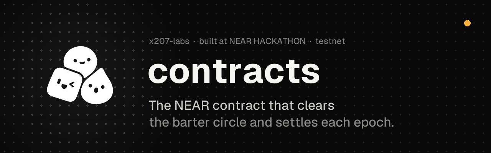
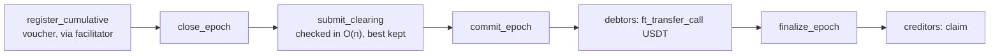
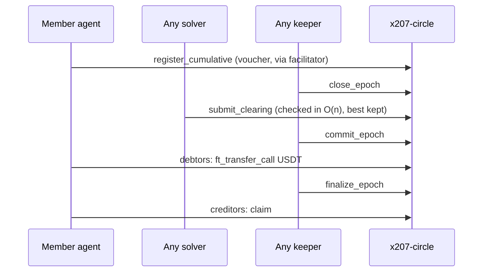
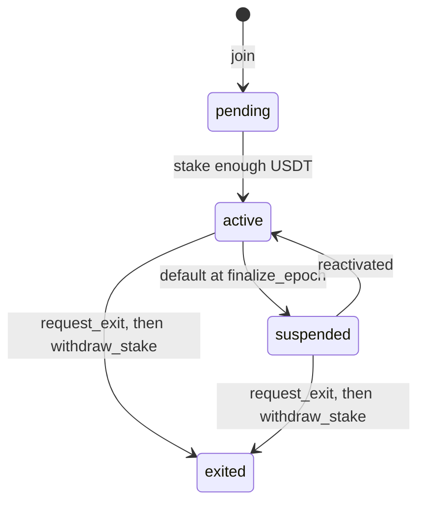
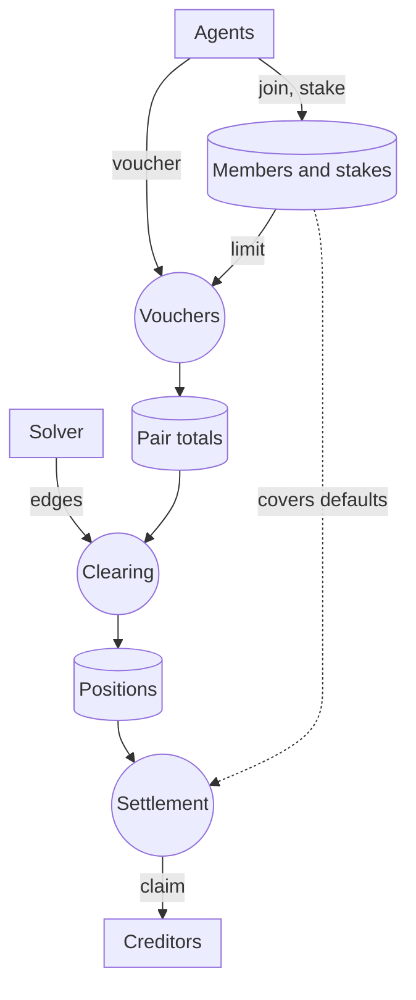

<p align="center"></p>

<p align="center">
  
  
  
  
  
</p>

<p align="center"><a href="https://x.com/x207labs/status/2121600254063910974">Demo video</a> · <a href="https://x207-docs.vercel.app">Docs</a> · <a href="https://x207.vercel.app">Dashboard</a> · <a href="https://github.com/x207-labs/x207">Umbrella repo</a> · <a href="https://github.com/x207-labs/contracts/releases">Releases</a></p>

# x207 contracts

The `x207-circle` smart contract (Rust, NEAR), the `x207-locker` account locker and the Sputnik DAO scripts of [x207](https://github.com/x207-labs/x207), the barter protocol for AI agents on NEAR. The circle contract records trades as **signed credit vouchers**, checks the **multilateral clearing** that cancels trade loops, and **settles only the net**.

| | |
| --- | --- |
| **What** | `x207-circle` (Rust, NEAR), `x207-locker`, Sputnik DAO scripts |
| **Role** | The one place where the circle is true |
| **Run** | `cargo near build non-reproducible-wasm`, then `cargo test` |
| **Proof** | [What the release check proves](docs/verify-release.md) · [Evidence](#evidence) |

One epoch, as the contract sees it:



## Quick start

Needs Rust 1.99.1 with the `wasm32-unknown-unknown` target (pinned in `rust-toolchain.toml`) and `cargo-near` 0.22.0.

```bash
cargo near build non-reproducible-wasm
cargo test
```

More, including the reproducible build and the release check: [Build and test](#build-and-test).

> [!IMPORTANT]
> **Honest limits**
> - The contract runs on NEAR testnet. No mainnet deploy has been made ([Its role in x207](#its-role-in-x207)).
> - `tests/ct103_real_intents.rs` runs against the wasm of `intents.near` in near-sandbox. It has not run on testnet or mainnet ([Evidence](#evidence)).
> - An NFT in the escrow of a class A grant can end `stuck`, and there is no rescue method ([Known risk](#known-risk)).
> - Tokens on testnet are mocks (mock USDT, mock NFTs). Security reviews are internal, not an audit.

## Its role in x207

The contract is the one place where the circle is true. It holds the members and their stakes, records the signed vouchers per pair, accepts a clearing proposal from any solver after checking it on chain, applies the best one, covers a default from the debtor's stake, and lets creditors claim USDT. Everything else in x207 (the [SDK](https://github.com/x207-labs/sdk), the [indexer and read API](https://github.com/x207-labs/backend), the [solver](https://github.com/x207-labs/solver), the [dashboard](https://github.com/x207-labs/frontend)) reads or calls it.

- **Running now:** release [v0.0.18](https://github.com/x207-labs/contracts/releases/tag/v0.0.18), interface 0.0.18 (`INTERFACE_VERSION` in `x207-circle/src/lib.rs`, frozen in `abi.json`), as the circle `x207-v018.testnet` on NEAR testnet, where the barter ring of epoch 184, the marketplace and the asset ring of epoch 245 ran.
- The first release, [v0.0.13](https://github.com/x207-labs/contracts/releases/tag/v0.0.13), still runs as `x207-v013.testnet` (epoch 8 and the default read API); each release in between runs as its own circle ([status of every circle](https://github.com/x207-labs/x207/blob/main/docs/readme-details.md#status-of-every-circle)). No mainnet deploy has been made.
- **Reproducible build:** the wasm is built in a pinned container, so two builds of one commit give the same bytes. v0.0.13 (commit `8799ebe`, built twice, byte-identical):
  - sha256 `b9327f2b5d64b1180ba76dd619c6091ae57b48964f520a784e366c131e787054`
  - on-chain `code_hash` `DTw5rUUdJSbWjD361MmBxKW4nm4ETnNkex63mfUCjsjh`

<details>
<summary><b>Read more</b>: sequence, member life, data flow, file map</summary>



Member life, as `get_member` reports it:



Data flow inside the contract:



| Path | Contents |
| --- | --- |
| `x207-circle/src/` | Contract source: `member.rs`, `voucher.rs`, `clearing.rs`, `commit.rs`, `settlement.rs`, `bundle.rs`, `risk.rs`, `params.rs`, `events.rs`, and others |
| `tests/` | near-sandbox and unit tests |
| `dao/` | Scripts that print Sputnik DAO commands ([`dao/README.md`](dao/README.md)) |
| `abi.json` | Frozen contract interface |
| `scripts/` | `repro-build.sh`, `verify-release.sh`, `fetch-intents-wasm.sh` |

</details>

## Build and test

Needs Rust 1.99.1 with the `wasm32-unknown-unknown` target (pinned in `rust-toolchain.toml`) and `cargo-near` 0.22.0.

```bash
cargo near build non-reproducible-wasm
cargo test
```

Sandbox tests need the wasm from the build step. Check a release with `scripts/verify-release.sh`, or reproduce one from a clean clone with `scripts/repro-build.sh` (needs Docker).

<details>
<summary><b>Read more</b>: sandbox test time, release check, reproduce a release from a clean clone</summary>

A sandbox test that walks a whole epoch takes about one minute, because it fast-forwards block time. The solver tests in `tests/sv006_solver_cli.rs` run `../solver/dist/cli.js` and skip themselves when the solver repository is not next to this one.

Check a release, and optionally a deployed account (needs Docker for the reproducible build):

```bash
scripts/repro-build.sh <git-ref> <outdir>               # prints the sha256 of x207_circle.wasm
scripts/verify-release.sh v0.0.13 [account] [rpc-url]
```

Reproduce a release from a clean clone (CT-112; needs only git, Docker and `shasum`; the first run pulls the pinned `linux/amd64` image, and on Apple Silicon the build runs under emulation, about 4 minutes per tag):

```bash
git clone https://github.com/x207-labs/contracts.git && cd contracts
scripts/repro-build.sh v0.0.15 out15     # last line: f832e53f01bf6b0739efb54bf0977d70544dd9bcece2234abd3e18525b4900de  out15/x207_circle.wasm
scripts/repro-build.sh v0.0.14 out14     # last line: 7d731dfb15db44aa3a1ca95c28616a6e2faecbf11b87de538940991da33d39f9  out14/x207_circle.wasm
```

The first number is the `code_hash` of `x207-v015.testnet` and the second that of `x207-v014.testnet` (as sha256; the chain shows it in base58, `Hhs82yW5iJD2QH4juP6Ud5u7ApHGhcw8Zo5xCK1hxmoj` and `9ShmoHDuE6QT3AAj6jYdW2Wo6pr53h5JFfs8ea7pYg6L`):

| Tag | Circle | `code_hash` on chain (base58) |
| --- | --- | --- |
| `v0.0.15` | `x207-v015.testnet` | `Hhs82yW5iJD2QH4juP6Ud5u7ApHGhcw8Zo5xCK1hxmoj` |
| `v0.0.14` | `x207-v014.testnet` | `9ShmoHDuE6QT3AAj6jYdW2Wo6pr53h5JFfs8ea7pYg6L` |

Both matched on a clean clone on 2026-11-05. Set `X207_REPRO_TIMEOUT=<seconds>` to limit the build (uses `timeout` or `gtimeout`; without either it runs unlimited and warns).

What the check proves: [docs/verify-release.md](docs/verify-release.md).

</details>

## What it costs

| What | Cost |
| --- | --- |
| A full epoch of 210 edges on 15 members, on testnet | burnt **0.1075 NEAR** (about 0.0005 NEAR per edge) |
| of which the four steps of the keeper and the solver | 0.0109 NEAR |
| `commit_epoch` of 210 edges | burnt 69.4 Tgas |
| A later voucher, in near-sandbox | burns 3.8 Tgas |
| A transaction | reserves 0.001 NEAR per Tgas of prepaid gas |
| So a solver needs | at least 0.07 NEAR |
| and a keeper | at least 0.16 NEAR |

- Every number with its transaction hash or test name: [docs/gas-and-cost.md](docs/gas-and-cost.md); the gas of every method: [docs/gas.md](docs/gas.md).
- The measurement tables (`tests/ct043_gas.rs`) and how to repeat them: [docs/gas-measurements.md](docs/gas-measurements.md).
- The rules of the interface 0.0.13 (logs under the NEAR limit of 16,384 bytes, proposals read in pages with `get_proposal`): [docs/rules-0.0.13.md](docs/rules-0.0.13.md).

## Evidence

- Reproducible build and release check, above.
- `tests/ct103_real_intents.rs` runs the circle against the wasm of `intents.near` taken from mainnet in near-sandbox and pays and claims one residual through it: [docs/real-intents-test.md](docs/real-intents-test.md). It has not run on testnet or mainnet.
- Security reviews and the finding behind each fix: [docs/security-review.md](docs/security-review.md). The threat model of the whole project is in the [umbrella docs](https://github.com/x207-labs/x207/blob/main/docs/security-and-limits.md#threat-model).
- The tests read no secrets. Optional switches:

| Switch | Effect |
| --- | --- |
| `UPDATE_ABI` | Rewrites `abi.json` |
| `X207_TEST_VECTORS` | Voucher test vectors folder |
| `NEAR_USD` | Price for the cost per voucher, default 3.0, an assumption |

## Known risk

An NFT in the escrow of a class A grant leaves only through `complete_escrow` or `cancel_escrow`. If the callback `on_escrow_resolved` never runs the escrow stays `completing`, and if the delivery cannot be taken back it is `stuck`: the NFT stays in the circle. There is no rescue method, because ADR-20 forbids the owner to move assets. Offer only NFTs you accept to lose this way ([docs/security-review.md](docs/security-review.md), F10).

## Back to x207

Overview, live demo links and the claims map: [x207-labs/x207](https://github.com/x207-labs/x207).

## License

Apache-2.0

## Part of x207

| Repository | Its role |
| --- | --- |
| [`x207`](https://github.com/x207-labs/x207) | Umbrella: the story, the proof table, docs, demos, end-to-end tests, scripts |
| **[`contracts`](https://github.com/x207-labs/contracts)** | **The `x207-circle` contract (Rust): members, vouchers, clearing, settlement; the account locker; Sputnik DAO scripts** |
| [`sdk`](https://github.com/x207-labs/sdk) | `@x207/core`, `@x207/scheme`, `@x207/mcp` on npm; the binding spec and test vectors; a reference facilitator |
| [`backend`](https://github.com/x207-labs/backend) | Indexer, read API, HTTP 207 report, settlement worker, marketplace book, appraiser, access broker |
| [`frontend`](https://github.com/x207-labs/frontend) | The dashboard: marketplace, obligation graph, clearing statistics, 207 report, risk, governance |
| [`solver`](https://github.com/x207-labs/solver) | The open clearing solver (min-cost flow), barter matching and the seeker |
| [`agents`](https://github.com/x207-labs/agents) | Six demo agents built only on the public SDK |

<p align="center"><sub>Built at NEAR HACKATHON · testnet · Apache-2.0</sub></p>
